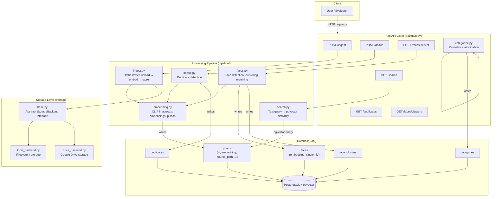
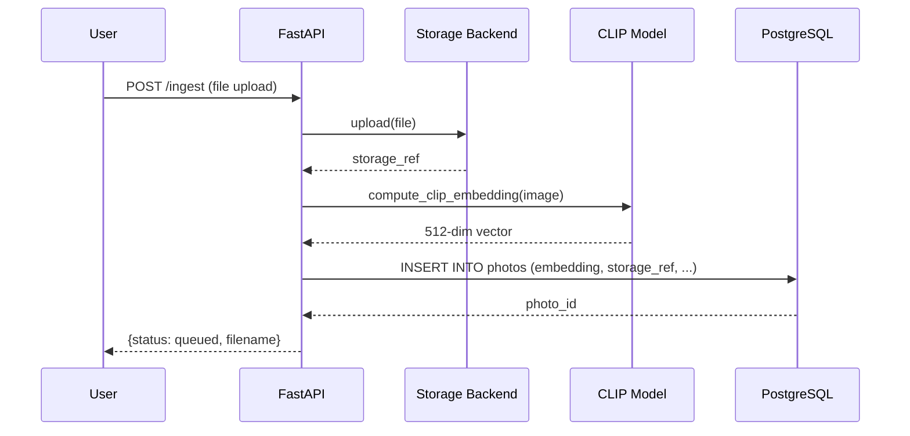
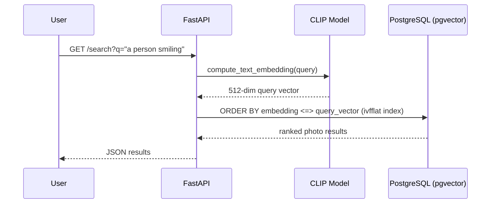

# Architecture & Design Decisions

## System Overview

The AI Photo Management Platform ingests photos from local storage or Google Drive, computes CLIP embeddings and face encodings for each image, and stores everything in PostgreSQL with pgvector for fast similarity search. A FastAPI layer exposes ingestion, search, deduplication, face clustering, and categorization as REST endpoints.

## Data Flow: Ingestion

## Data Flow: Natural Language Search

## Key Design Decisions

### 1. CLIP for both image and text embeddings (shared vector space)
**Decision:** Use OpenCLIP (`ViT-B-32-quickgelu`, OpenAI weights) for image embeddings, and the same model's text encoder for natural language queries.
**Why:** CLIP maps images and text into the same embedding space, so a query like "a dog on a beach" and a matching photo land close together — this is what makes natural language search possible without training a custom model. Also reused for zero-shot categorization, avoiding the need for a separate classifier.
**Trade-off:** CPU inference is slower than a smaller/specialized model would be, but avoids the cost and complexity of training/fine-tuning anything.

### 2. pgvector over a dedicated vector database
**Decision:** Store embeddings as a `vector` column in PostgreSQL (via the pgvector extension) rather than using a separate vector DB (Pinecone, Weaviate, Milvus, etc.).
**Why:** Keeps the stack simpler — one database for both relational metadata (photo paths, timestamps, face clusters) and vector search, with a single source of truth and standard SQL joins between them. An `ivfflat` index provides approximate nearest-neighbor search that's fast at scale (verified up to 13,000+ images) without needing separate infrastructure.
**Trade-off:** A dedicated vector DB would likely out-perform pgvector at very large scale (100M+ vectors) or offer more advanced indexing options, but for this use case pgvector's performance was more than sufficient and the operational simplicity was worth it.

### 3. Perceptual hash (pHash) + CLIP for two-tier deduplication
**Decision:** Use pHash for fast exact/near-exact duplicate detection (e.g. the same photo saved twice, resized, or recompressed), and CLIP cosine similarity for semantic near-duplicates (e.g. burst-mode shots of the same scene).
**Why:** pHash is extremely cheap to compute and compare (bit-level Hamming distance), so it's the first-pass filter. CLIP similarity catches duplicates that pHash would miss (different crop/lighting of the same subject) but is more expensive, so it's used more selectively.

### 4. Pluggable storage backend (Strategy pattern)
**Decision:** Define an abstract `StorageBackend` interface (`upload`, `get_url`, `delete`) with local filesystem and Google Drive implementations behind it.
**Why:** The rest of the pipeline (ingestion, dedup, search) never needs to know which storage backend is active — it just calls the interface. This makes it straightforward to add new backends (e.g. S3, Google Photos) later without touching pipeline logic.

### 5. Incremental face clustering vs. full batch re-clustering
**Decision:** Track a `faces_processed` flag per photo, and match new faces against existing cluster centroids (nearest-neighbor) rather than re-running full DBSCAN clustering across the entire face history on every call.
**Why:** Full batch re-clustering on every run doesn't scale — at 13,000+ images it would mean re-processing the entire face history every time a single new photo is added. Incremental matching only processes new/unprocessed photos.
**Trade-off (discovered during testing):** this approach is vulnerable to error chaining — since each new face is matched only against its single nearest neighbor rather than re-validated against the whole cluster, visually similar-but-distinct people can occasionally merge into the same cluster over a long run, and the error compounds. This was observed directly: testing against the full 13,233-image LFW dataset produced one cluster of 1,056 faces that, on visual inspection, contained multiple different people. This is documented as a known limitation in the README, along with a proposed fix (periodic batch reconciliation, or stricter similarity thresholds with confidence-based merging) rather than silently accepting the incorrect result.

### 6. FastAPI Swagger UI as the interface (no custom frontend)
**Decision:** Expose all functionality via a FastAPI backend with its auto-generated Swagger UI (`/docs`) as the interactive interface, rather than building a separate frontend application.
**Why:** Given the assignment's focus on the AI/ML pipeline and backend architecture, a custom frontend was judged out of scope relative to the time available. Swagger UI provides a genuinely functional, testable interface for every endpoint (including direct image viewing via `/photos/{id}/image`) without additional frontend engineering.
**Trade-off:** Not as polished as a purpose-built UI, and not suitable for non-technical end users. A frontend is listed as a roadmap item.

### 7. Google Photos integration via the Picker API (not the Library API)
**Decision:** Implemented Google Photos import using the **Photos Picker API** rather than the (now-restricted) Photos Library API.
**Why:** As of April 2025, Google restricted the Library API so that new/unverified apps can no longer list a user's entire existing photo library (`photoslibrary.readonly` requires a formal Google security verification process that takes weeks and is intended for production apps with real users). The Picker API is Google's current recommended path for third-party apps: the user explicitly selects photos through Google's own picker UI (`https://photos.google.com/integration/picker/...`), and the app receives temporary, scoped access only to those selected items.
**Flow:** `POST /google-photos/session` creates a session and returns a `picker_uri`; the user opens it, selects photos, and the app polls until selection is complete; `POST /google-photos/session/{id}/import` then downloads each selected item and feeds it through the existing `ingest_photo()` pipeline — reusing the same OAuth credentials (extended with the `photospicker.mediaitems.readonly` scope) and storage/embedding logic already built for Drive.
**Verified:** tested live against a real Google account — 12 real photos selected via the picker, downloaded, and successfully ingested with embeddings into the running database.
**Trade-off:** unlike full library listing, the Picker API only provides access to photos the user actively selects in each session — there's no way to browse/search the user's full library from within the app before they've picked anything already exists (or `Google Drive` storage, which does support full listing since Drive's more permissive API model wasn't affected by the same restriction).

## Scale Testing Summary

The system was stress-tested against the full LFW dataset (13,233 images) — see `README.md`'s "Scaling Considerations" section for full details. Summary:

| Component | Result at 13,233 images |
|---|---|
| Bulk ingestion (batched CLIP) | ~458 seconds (~29 images/sec) |
| Natural language search | Milliseconds (pgvector `ivfflat` index) |
| Deduplication | Fast, index-backed nearest-neighbor query |
| Face clustering (initial run) | ~1 hour (synchronous, unbatched — documented bottleneck) |
| Face clustering (accuracy) | Degrades on large libraries — documented limitation |
| Face clustering (re-runs) | Near-instant (incremental, only processes new photos) |

The assignment specifies support for at least 100,000 images. The architecture (batched ingestion, pgvector indexing, incremental processing) is designed to extend to that scale, but was validated directly only up to 13,233 images due to time constraints — the honest, tested number is reported here rather than an untested claim of 100k support.