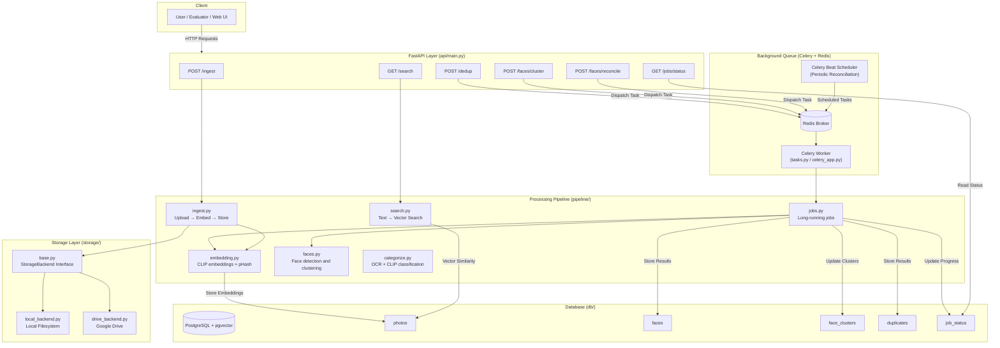
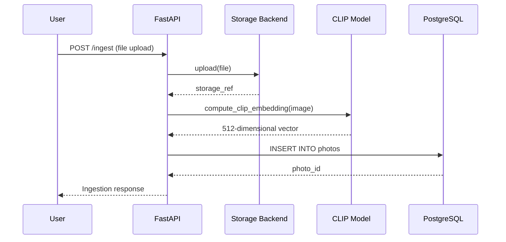
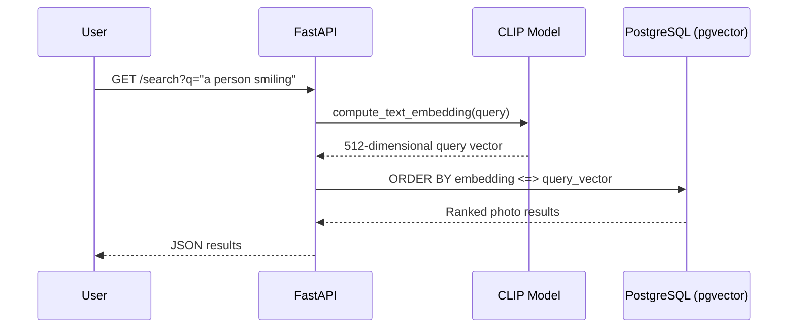
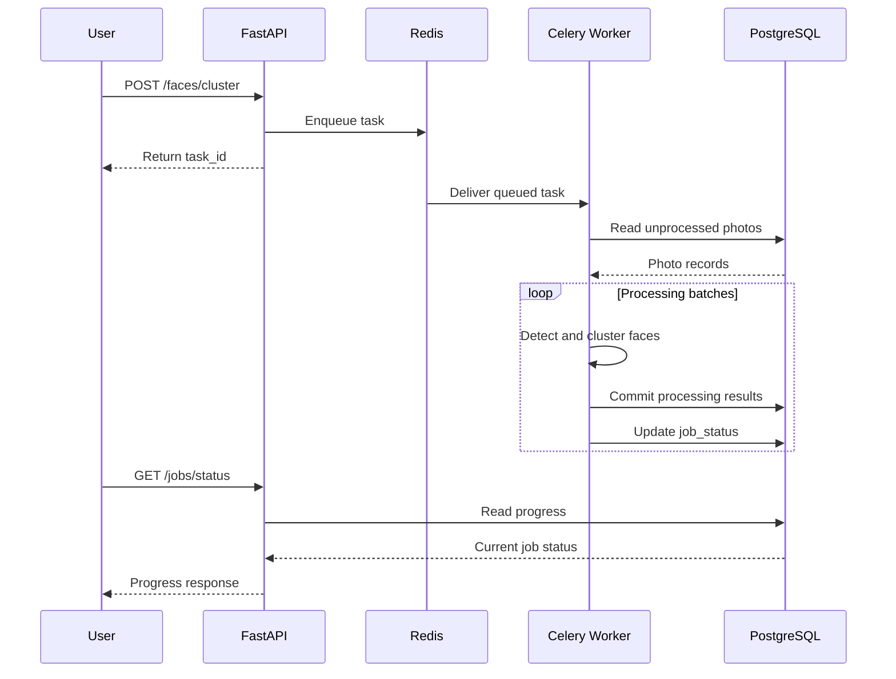

# Architecture & Design Decisions

## System Overview

The AI Photo Management Platform is a full-stack application designed to organize, search, and process large image collections using computer vision and machine learning.

The platform supports image ingestion from local storage, Google Drive, and Google Photos. It generates CLIP embeddings for semantic search, detects duplicates using perceptual hashing and vector similarity, groups faces using facial recognition, and categorizes images through a combination of Tesseract OCR and CLIP zero-shot classification.

The backend is built with FastAPI, while PostgreSQL and pgvector provide relational storage and vector similarity search.

Long-running operations are handled asynchronously using Celery workers and Redis. Celery Beat schedules periodic face-cluster reconciliation.

The system has processed **116,000+ images** across multiple datasets.

### High-Level Architecture



### Component Responsibilities

| Component            | Responsibility                                                              |
| -------------------- | --------------------------------------------------------------------------- |
| Vue 3 + Tailwind CSS | Gallery, search, uploads, face clusters, duplicate review, and job progress |
| FastAPI              | REST endpoints, request validation, and orchestration                       |
| PostgreSQL           | Persistent photo metadata, face clusters, duplicates, and job status        |
| pgvector             | Vector similarity search over CLIP embeddings                               |
| Redis                | Celery message broker and result backend                                    |
| Celery Worker        | Executes computationally expensive background jobs                          |
| Celery Beat          | Schedules periodic face-cluster reconciliation                              |
| OpenCLIP             | Image/text embeddings and zero-shot classification                          |
| Tesseract OCR        | Extracts text from document images                                          |
| face_recognition     | Face detection and face encodings                                           |
| DBSCAN               | Batch face clustering and reconciliation                                    |
| Docker Compose       | Coordinates application infrastructure                                      |

---

## Data Flow: Image Ingestion

The ingestion pipeline stores an uploaded image and generates its vector representation.

Bulk ingestion uses batched CLIP inference to improve CPU throughput.



### Bulk Ingestion

For large datasets, the platform provides a separate ingestion script:

```bash
python -m scripts.bulk_ingest /path/to/folder
```

The bulk-ingestion implementation batches 32 images per CLIP forward pass.

This reduces the overhead associated with processing images individually and improves CPU utilization.

Bulk ingestion and background face-clustering jobs are separate operations. An image being ingested does not imply that all downstream face-processing or deduplication operations have completed.

---

## Data Flow: Natural Language Search

The platform uses CLIP's shared image-text embedding space to search images using natural-language queries.

For example:

> a person smiling on a beach

The query is encoded into a vector using CLIP's text encoder.

PostgreSQL then ranks stored image embeddings by vector similarity.



The database uses a pgvector `ivfflat` index to support approximate nearest-neighbor search.

Search performance depends on factors including dataset size, index configuration, query selectivity, and available hardware. The index reduces the need for exhaustive vector comparisons, but does not guarantee constant query latency.

---

## Data Flow: Background Processing

Computationally expensive operations are executed outside FastAPI's HTTP request handlers.

The background-processing system uses Celery and Redis.



### Why Background Processing Is Necessary

The original implementation executed expensive processing operations directly within HTTP request handlers.

At larger dataset sizes, this caused several engineering problems:

* Requests could remain active for extended periods.
* Long-running processing increased the risk of HTTP timeouts.
* Interrupted operations could lose substantial progress.
* Users had limited visibility into processing status.
* CPU-intensive operations competed with API request handling.

The current implementation separates request handling from background processing.

FastAPI dispatches work to Redis, Celery workers execute it, and PostgreSQL stores persistent progress information.

---

# Key Design Decisions

## 1. CLIP for Image and Text Embeddings

**Decision:** Use OpenCLIP (`ViT-B-32-quickgelu`, OpenAI weights) for both image and text embeddings.

### Why

CLIP maps images and text into a shared embedding space.

This allows a natural-language query to be compared directly against stored image embeddings.

The same model is reused for zero-shot visual categorization, avoiding the need to train a separate image classifier.

### Trade-offs

CLIP inference is computationally expensive on CPUs compared with smaller specialized models.

However, it provides semantic image understanding without requiring a custom training dataset or model fine-tuning.

The current implementation prioritizes model reuse and development simplicity over GPU-optimized inference.

---

## 2. PostgreSQL + pgvector Instead of a Dedicated Vector Database

**Decision:** Store image embeddings in PostgreSQL using the pgvector extension.

### Why

The application already requires relational storage for:

* Image metadata
* Storage references
* Face information
* Face clusters
* Duplicate relationships
* Background job status

Using PostgreSQL for vector search avoids introducing a separate database system.

This provides a single source of truth for relational data and image embeddings.

### Indexing

An `ivfflat` index supports approximate nearest-neighbor search.

This reduces the amount of vector comparison work required for similarity queries.

### Trade-offs

Dedicated vector databases may offer advantages for substantially larger workloads or specialized vector-search requirements.

However, pgvector simplifies deployment, transactions, and relational joins.

The choice favors operational simplicity for the current application.

Search performance should be evaluated using measured query latency and retrieval quality rather than assuming that indexing makes latency independent of dataset size.

---

## 3. Two-Tier Duplicate Detection: pHash + CLIP

**Decision:** Combine perceptual hashing with CLIP-based vector similarity.

### Perceptual Hashing

pHash identifies visually similar images based on image structure.

It is useful for detecting:

* Repeated uploads
* Resized images
* Recompressed images
* Minor visual modifications

Hashes can be compared using Hamming distance.

### CLIP Similarity

CLIP embeddings capture higher-level visual semantics.

They can identify images that are semantically similar even when their pixel-level representations differ.

### Why Combine Them?

pHash is computationally inexpensive but has limited semantic understanding.

CLIP provides richer representations but requires more expensive inference and similarity comparisons.

Using both approaches provides complementary duplicate-detection capabilities.

### Trade-off

Semantic similarity does not necessarily mean two images are duplicates.

Similarity thresholds must be chosen carefully to avoid grouping distinct images of similar subjects.

---

## 4. Pluggable Storage Backend

**Decision:** Define an abstract `StorageBackend` interface with multiple implementations.

The interface supports operations such as:

```python
upload()
get_url()
delete()
```

Implementations include:

* Local filesystem storage
* Google Drive storage

### Why

The image-processing pipeline should not depend directly on a particular storage provider.

The storage abstraction separates image-processing logic from storage-specific operations.

### Benefits

* Storage providers can be replaced without rewriting the ML pipeline.
* The same ingestion logic can operate with different backends.
* Storage-specific behavior remains isolated.
* Additional providers can be introduced later.

### Trade-off

The abstraction adds implementation complexity compared with directly using filesystem operations.

However, it improves maintainability and extensibility.

---

## 5. Incremental Face Clustering with Periodic Reconciliation

**Decision:** Combine incremental face clustering with scheduled batch reconciliation.

### Original Approach

Re-running DBSCAN across every previously detected face whenever new images arrive would be computationally expensive.

Instead, the platform tracks processing status using a `faces_processed` flag.

New faces are matched against existing face information without repeatedly processing the entire photo collection.

### Why Incremental Processing?

Incremental processing reduces redundant computation.

It is particularly useful when users continuously add new images to an existing library.

Previously processed photos can be skipped during subsequent runs.

### Problem Discovered During Testing

Incremental nearest-neighbor matching can introduce clustering drift.

If two visually similar but distinct individuals are incorrectly grouped, subsequent matches may reinforce the incorrect grouping.

This issue was observed during testing on the **13,233-image LFW dataset**.

One cluster grew to **1,056 faces** and contained multiple distinct individuals.

This demonstrated that incremental matching alone was insufficient for maintaining cluster consistency.

### Implemented Solution: Periodic Reconciliation

The platform implements a reconciliation process that periodically re-evaluates oversized face clusters.

The reconciliation implementation is located in:

```text
pipeline/jobs.py
```

The corresponding background task is:

```text
tasks.reconcile_face_clusters
```

### Reconciliation Process

1. Identify face clusters exceeding a configurable size threshold.
2. Retrieve the face encodings belonging to each eligible cluster.
3. Re-cluster those faces using batch DBSCAN.
4. Apply a stricter similarity tolerance.
5. Compare the resulting groups with the existing cluster.
6. Preserve the original cluster ID for the largest resulting group.
7. Create new cluster IDs for additional groups.

### Configuration

| Parameter                    | Default | Purpose                                            |
| ---------------------------- | ------- | -------------------------------------------------- |
| `RECONCILE_SIZE_THRESHOLD`   | 30      | Minimum cluster size considered for reconciliation |
| `RECONCILE_TOLERANCE`        | 0.5     | DBSCAN clustering tolerance                        |
| `RECONCILE_INTERVAL_SECONDS` | 21,600  | Reconciliation scheduling interval (6 hours)       |

### Scheduling

Celery Beat schedules reconciliation jobs periodically.

Celery workers perform the actual processing.

Reconciliation can also be triggered manually:

```http
POST /faces/reconcile
```

### Trade-offs

Incremental clustering minimizes repeated processing but can introduce clustering errors.

Batch reconciliation provides a mechanism to correct some of those errors, at the cost of additional CPU processing.

The hybrid approach balances efficiency and cluster consistency.

**Limitation:** Reconciliation does not guarantee perfect identity separation. Accuracy remains dependent on face encoding quality, similarity thresholds, and image conditions.

---

## 6. Vue 3 SPA + Tailwind CSS with FastAPI

**Decision:** Provide a Vue 3 single-page interface alongside FastAPI's REST API.

The frontend is implemented in:

```text
frontend/index.html
```

Vue and Tailwind are loaded through CDN-based dependencies.

### Features

The interface provides:

* Infinite-scroll image gallery
* Natural-language image search
* Image upload and import
* Face-cluster browsing
* Side-by-side duplicate review
* Background job progress monitoring
* Google Photos Picker integration
* Dashboard statistics

### Why

The web interface makes the system usable without requiring users to interact directly with REST endpoints.

FastAPI also exposes interactive API documentation through:

```text
/docs
```

### Architecture

The frontend communicates with FastAPI over HTTP.

CORS middleware allows the frontend to be served separately from the API.

The application can be run locally using the frontend HTML file or served through the project's UI-serving script.

### Trade-off

The CDN-based frontend simplifies development and avoids a separate frontend build pipeline.

However, it is less suitable for a large, independently deployed frontend application than a conventional bundled Vue project.

---

## 7. Cross-Platform Path Normalization

**Decision:** Normalize stored file paths to forward slashes.

### Problem

During development on Windows, some image paths were stored using backslashes:

```text
images\folder\photo.jpg
```

When the application ran inside Linux-based Docker containers, those paths caused compatibility problems.

Linux does not interpret Windows-style backslashes as directory separators.

### Solution

Normalize storage references and source paths to use forward slashes.

A migration script is provided:

```bash
python -m scripts.fix_paths
```

### Why

Consistent path representation reduces differences between Windows development environments and Linux containers.

### Trade-off

Existing database records may require migration when changing path conventions.

The normalization strategy improves portability but does not eliminate the need to handle platform-specific filesystem behavior carefully.

---

## 8. Google Photos Integration Through the Picker API

**Decision:** Use the Google Photos Picker API rather than relying on unrestricted Google Photos Library API access.

### Why

Google introduced restrictions affecting third-party access to existing Google Photos libraries.

The Picker API allows users to explicitly select photos that an application may access.

This provides a user-controlled import workflow.

### Import Flow

1. The user initiates a Google Photos import.
2. FastAPI creates a Picker session.
3. The application returns a Picker URL.
4. The user selects photos through Google's interface.
5. The application waits for the selection to complete.
6. Selected images are downloaded.
7. Images are passed through the existing ingestion pipeline.

### API Endpoints

```http
POST /google-photos/session
```

```http
POST /google-photos/session/{id}/import
```

### Validation

The integration was tested with a real Google account.

Twelve selected images were downloaded and successfully ingested with embeddings.

### Trade-off

The Picker API does not provide unrestricted access to a user's entire photo library.

Users must explicitly select the photos they want to import.

This limits automated full-library synchronization but aligns with the access model supported by the API.

---

## 9. Asynchronous Task Processing with Celery and Redis

**Decision:** Execute long-running operations through Celery workers using Redis as the message broker and result backend.

### Background Operations

The following endpoints dispatch background tasks:

```http
POST /dedup
```

```http
POST /faces/cluster
```

```http
POST /faces/reconcile
```

### Components

**FastAPI**

Receives HTTP requests, validates inputs, and dispatches background tasks.

**Redis**

Transports queued tasks between FastAPI and Celery workers.

**Celery Worker**

Executes computationally expensive operations independently of the API process.

**Celery Beat**

Schedules recurring face-cluster reconciliation.

**PostgreSQL**

Stores persistent job progress and processing state.

### Why

Separating expensive operations from request handling improves responsiveness and reduces the risk of HTTP request timeouts.

It also allows users to monitor progress while work continues asynchronously.

### Job Progress

Workers update persistent records in the `job_status` table.

The frontend can retrieve progress through:

```http
GET /jobs/status
```

Or retrieve the status of a specific task:

```http
GET /jobs/{task_id}
```

### Scheduling

Celery Beat triggers face-cluster reconciliation every six hours by default.

The schedule can be configured using:

```text
RECONCILE_INTERVAL_SECONDS
```

### Trade-offs

Background processing introduces additional infrastructure and operational complexity.

The system must coordinate task execution, retries or resumability, persistent progress, and worker availability.

However, this separation is more appropriate for CPU-intensive operations on large image collections than executing those operations synchronously inside HTTP requests.

---

## 10. OCR-Based Document Classification

**Decision:** Use Tesseract OCR and keyword matching for text-heavy images, while retaining CLIP for visual categorization.

### Problem

Initial testing showed that CLIP-only classification was unreliable for certain document categories.

For example, a query involving prescriptions could retrieve images of eyeglasses because of the semantic association between prescriptions and prescription glasses.

CLIP captures visual and semantic relationships but does not reliably extract and interpret document text.

### Solution

The platform uses two classification paths.

**Path 1: Text-heavy images**

Tesseract OCR extracts text from the image.

If sufficient text is detected, keyword matching determines the document category.

Examples include:

* Prescriptions
* Receipts
* General documents

**Path 2: Visual images**

Images that do not meet the text threshold are classified using CLIP zero-shot classification.

Supported visual categories include:

* People
* Pets
* Travel
* Food
* Nature
* Vehicles
* Screenshots
* Other

### Validation

The OCR-based approach was tested using the Tobacco3482 dataset, which contains scanned document images.

The test demonstrated that OCR-derived text could support document classification where CLIP-only classification had produced inappropriate results.

### Trade-offs

Keyword-based document classification is simple, transparent, and debuggable.

However, it depends on OCR quality and predefined keywords.

Poor-quality scans, unusual document layouts, and unfamiliar terminology can reduce classification accuracy.

---

# Scalability and Performance Testing

## Dataset Coverage

The platform has processed more than **116,000 images** across multiple datasets and image sources.

| Dataset                  |            Images | Primary Purpose                  |
| ------------------------ | ----------------: | -------------------------------- |
| LFW                      |            13,233 | Face detection and clustering    |
| STL-10 (unlabeled split) |           100,000 | Large-scale ingestion            |
| Tobacco3482              |             3,482 | OCR and document classification  |
| Google Photos imports    | Additional images | External photo import validation |

The datasets serve different testing purposes.

The combined image count should not be interpreted as evidence that every application feature was benchmarked end-to-end across the entire collection.

---

## Bulk Ingestion Benchmarks

Bulk ingestion uses batched CLIP inference with a batch size of 32 images.

| Dataset |  Images | Ingestion Time | Approximate Throughput |
| ------- | ------: | -------------: | ---------------------: |
| LFW     |  13,233 |    458 seconds |          29 images/sec |
| STL-10  | 100,000 |  3,876 seconds |          26 images/sec |

These results demonstrate the ability to ingest large datasets using CPU-based inference.

The throughput figures are calculated from the recorded ingestion times.

### Interpretation

The benchmark measures bulk-ingestion throughput.

It does not establish the same throughput for:

* Face detection
* Face clustering
* Duplicate detection
* OCR classification
* Cluster reconciliation

Those operations have different computational characteristics.

---

## Engineering Challenges at Scale

### 1. Long-Running HTTP Requests

**Problem:** CPU-intensive operations originally ran directly inside request handlers.

At larger dataset sizes, processing could take substantially longer than a typical HTTP request.

**Solution:** Move expensive jobs into Celery workers.

**Result:** API requests can return a task identifier while processing continues asynchronously.

---

### 2. Large Database Transactions

**Problem:** Long-running jobs initially committed their results only after processing the entire dataset.

An interruption could therefore cause significant work to be lost.

**Solution:** Commit processing results periodically.

Current documented batch intervals include:

* Deduplication: every 2,000 photos
* Face clustering: every 500 photos

**Result:** Completed batches can remain persisted even when a later part of the operation fails.

---

### 3. Reprocessing Previously Completed Images

**Problem:** Restarting a long-running operation could cause already processed images to be scanned again.

**Solution:** Track processing state using database flags.

Examples include:

```text
dedup_processed
faces_processed
```

**Result:** Subsequent runs can skip previously completed images.

This reduces unnecessary repeated processing.

---

### 4. Excessive Database Queries

**Problem:** Repeated database lookups during duplicate detection increased processing overhead.

**Solution:** Use an in-memory lookup set where appropriate to avoid redundant queries.

**Trade-off:** In-memory lookup structures consume additional application memory.

However, they can reduce database round trips during batch processing.

---

### 5. Face-Cluster Drift

**Problem:** Incremental face matching occasionally grouped distinct individuals into the same cluster.

The issue was observed on the LFW dataset, where one cluster grew to 1,056 faces.

**Solution:** Implement periodic DBSCAN-based reconciliation through Celery.

**Result:** The system has a mechanism for revisiting oversized clusters and splitting inconsistent groups.

This is a corrective mechanism, not a guarantee of perfect clustering accuracy.

---

### 6. Progress Visibility

**Problem:** Long-running operations provided limited visibility into how much work had been completed.

**Solution:** Persist job progress in PostgreSQL.

Workers update the job-status records, and the frontend polls the API for progress information.

**Result:** Users can monitor long-running jobs without keeping the original request open.

---

## Search and Indexing

Natural-language search uses CLIP text embeddings and pgvector similarity queries.

An `ivfflat` index supports approximate nearest-neighbor retrieval.

### Performance Considerations

Indexing helps avoid exhaustive comparisons across all stored embeddings.

However, search latency depends on:

* Number of indexed vectors
* Index configuration
* PostgreSQL execution plans
* Available CPU and memory
* Query workload
* Concurrent database activity

The current documentation does not claim constant search latency or a verified latency percentile at 116K+ images.

A dedicated benchmark would be required to establish those figures.

---

## Face-Clustering Performance

Initial face-clustering tests exposed both computational and accuracy limitations.

The earlier synchronous implementation required approximately one hour during the documented LFW-scale test.

Subsequent architectural improvements introduced:

* Incremental processing
* Persistent processing flags
* Periodic database commits
* Celery background execution
* Scheduled cluster reconciliation

These changes address operational limitations of the earlier implementation.

They do not, by themselves, establish a new measured end-to-end face-clustering runtime.

---

# Deployment Architecture

The application is containerized using Docker Compose.

The full-stack configuration includes five services.

| Service  | Responsibility                         |
| -------- | -------------------------------------- |
| `db`     | PostgreSQL with pgvector               |
| `redis`  | Task message broker and result backend |
| `api`    | FastAPI application                    |
| `worker` | Celery background task execution       |
| `beat`   | Scheduled task dispatch                |

### Start the Full Stack

```bash
docker compose up -d
```

### Check Running Services

```bash
docker compose ps
```

### View Logs

```bash
docker compose logs -f
```

### Stop Services

```bash
docker compose down
```

The application currently runs locally.

Docker Compose simplifies the process of starting the required services and reproducing the development environment.

Public deployment is not required for the existing architecture to function.

---

# Known Architectural Limitations

## 1. CPU-Based Model Inference

CLIP and face-processing workloads currently run without GPU acceleration.

This limits inference throughput, especially for computationally expensive face-detection models.

GPU acceleration could improve performance but would introduce additional hardware and deployment requirements.

## 2. Face-Clustering Accuracy

Incremental clustering can introduce identity-matching errors.

Periodic reconciliation provides a correction mechanism but does not guarantee perfect clustering.

## 3. OCR Reliability

Document classification depends on Tesseract OCR quality.

Blurry images, skewed documents, unusual layouts, and low-resolution scans can reduce text extraction accuracy.

## 4. Keyword-Based Document Classification

The document-classification path uses extracted text and keyword matching rather than a trained text classifier.

This simplifies debugging but limits generalization to unfamiliar document formats.

## 5. Database Migration Management

The project uses manual and inline migration scripts rather than a dedicated migration framework.

A production deployment would benefit from versioned migrations using a tool such as Alembic.

## 6. Google Drive Error Handling

The Google Drive storage backend does not provide comprehensive automated retry handling beyond the underlying API behavior.

A production implementation would benefit from structured retry policies and better failure recovery.

## 7. Google Photos Access Restrictions

The Google Photos Picker API requires users to select images explicitly.

The application cannot automatically enumerate a user's entire existing photo library through the Picker API.

## 8. Search Benchmark Coverage

The application uses indexed vector search, but the documentation does not establish verified latency percentiles at the full 116K+ image scale.

A repeatable benchmark covering query latency, recall, and concurrent load would provide stronger evidence of search performance.

---

# Architecture Summary

The AI Photo Management Platform combines computer vision, vector search, background processing, and relational data management in a single application.

The major architectural decisions are:

1. **OpenCLIP** provides shared image-text embeddings for semantic search and visual categorization.
2. **PostgreSQL + pgvector** combines relational storage with vector similarity search.
3. **pHash and CLIP** provide complementary duplicate-detection methods.
4. **A storage abstraction** separates the processing pipeline from storage providers.
5. **Incremental face clustering** avoids unnecessary repeated processing.
6. **Periodic DBSCAN reconciliation** addresses clustering drift.
7. **Tesseract OCR** improves classification of text-heavy images.
8. **Celery and Redis** isolate expensive processing from HTTP request handling.
9. **Persistent job tracking and processing flags** support progress monitoring and resumable workloads.
10. **Docker Compose** provides a reproducible local runtime.

The platform has demonstrated bulk ingestion across datasets totaling more than 116,000 images.

The larger workload also exposed practical engineering challenges involving transaction size, request handling, repeated processing, database queries, and clustering consistency.

The resulting architecture prioritizes maintainability, operational reliability, and the ability to process large image collections while keeping the API responsive.
